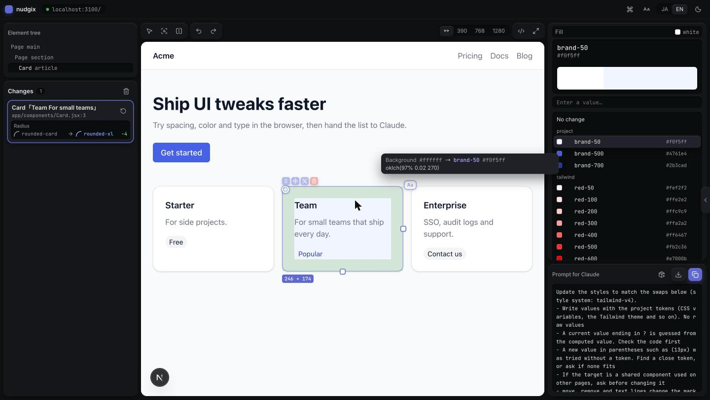
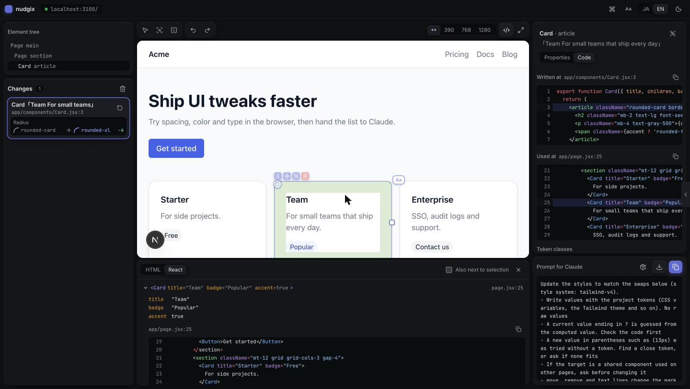

# nudgix

手元で動いている画面をブラウザで少しずつ直してみて、その一覧をAIのコーディングエージェント向けのプロンプトにして渡す道具です。プロンプトはただのテキストなので、Claude Code、Codex、Cursorなど、どのエージェントにも渡せます。ソースは書き換えません。

[English](README.md)



```sh
cd your-app
npm run dev          # いつもどおりdevサーバーを起動する
npx nudgix start     # http://localhost:4747/__nudgix/ でエディタが開く
```

nudgixは画面を枠の中に出し、その上で次のことを試せます。

- 色・文字・余白・サイズ・角丸・影を、プロジェクトのトークンで差し替える。トークンにカーソルを置くと、その場で画面に当たります
- 余白の帯やハンドルを画面の上でドラッグする。要素の並べ替え・移動、文字の書き換え、削除、見た目だけのずらしもできます
- Storybookのストーリーを画面に置き、Propsを変える
- 選んだ要素を、HTMLと、ReactかVueの部品（Props、書いたソースの行）で見る。変更が入る行には印が付きます
- 要素に、AIへのコメントを自由に書いて付ける
- 全部をプロンプトにしてコピーする。要素ごとに、書いた場所と変更の内容が並びます



## スタイルの仕組み

トークンはアダプターを通して読みます。アダプターは`package.json`から選びます。

| アダプター | トークン | プロンプトでの書き方 |
|---|---|---|
| `tailwind-v4` | Tailwindの既定のテーマと、プロジェクトの`@theme` | ユーティリティ：`pt-4`、`rounded-xl`、`bg-brand-500` |
| `panda` | Panda CSSのトークン。名前は`panda codegen`で出る`styled-system/tokens`から取ります | トークンのパス：`'brand.500'`、`'6'` |
| `stylex` | `*.stylex.*`ファイルの`defineVars`。画面の変数とは値で突き合わせます | 変数：`colors.brand`、`space.s4` |
| `css-vars` | 画面のスタイルシートで`:root`に書かれたカスタムプロパティ。どの構成でも動きます | 変数名：`--space-4` |

## オプション

```sh
npx nudgix start --target 3001 --port 4800
```

| オプション | 既定 |
|---|---|
| `--target` | `dev`スクリプトにあるポート（`next dev -p 3100`）。無ければフレームワークの既定（Next.jsは3000、Viteは5173、Astroは4321） |
| `--port` | `4747` |
| `--dir` | 今いるフォルダ |
| `--storybook` | `6006` |
| `--no-open` | 付けなければブラウザを開く |

## Claude Codeのスキル

Claude Codeを使う人向けの、入れなくてもよい機能です。プロンプト欄のボタンで、プロジェクトに`/apply-nudges`スキル（`.claude/skills/apply-nudges/`）を入れられます。入れると、プロンプトは進め方の説明を省き、`/apply-nudges`とアダプターと変更だけになります。すでにスキルがあるときは上書きしません。ほかのエージェントにもプロンプトを渡すなら、スキルは入れないでください。ほかのエージェントは`/apply-nudges`を知らないためです。

## 制限

- 書いた場所が分かるのは、ReactかVueの開発ビルドのときです。Reactで確かめているのはNext.js（Turbopackかwebpack）とViteで、ほかのReactの構成でも動くかもしれません。Vueは部品ごとの`.vue`ファイルしか分からないため、そのファイルの中で要素をクラス名、次にタグ名で探します。そのため行がずれることがあります。ほかのフレームワーク（SvelteやSolidなど）では書いた場所は出ません。ReactもVueも使っていない画面では、要素に当たっているCSSの規則の場所を出します。ただし、devサーバーがCSSのファイル名を教えてくれるとき（Viteなど）に限ります
- 画面のアプリ自体がViteで動いていると、Storybookのギャラリーは使えません。どちらも同じパスを使うためです
- 変更はブラウザに保存し、画面の中の位置で要素を探し直します。画面の構造が変わると見つからなくなることがあります

## 開発

```sh
pnpm install
pnpm dev --dir examples/next-tailwind-v4   # エディタをソースからViteで動かす
pnpm build                                 # エディタをdist/にビルドする
node server/tailwind.test.mjs
node server/stylex.test.mjs
```

見本アプリは、それぞれのフォルダで`pnpm install`と`pnpm dev`を実行してください。`examples/next-tailwind-v4`は3100番、`examples/vite-css`は5173番、`examples/vite-react-panda`は5174番、`examples/vite-react-stylex`は5175番、`examples/vite-vue`は5176番で動きます。

## ライセンス

MIT
