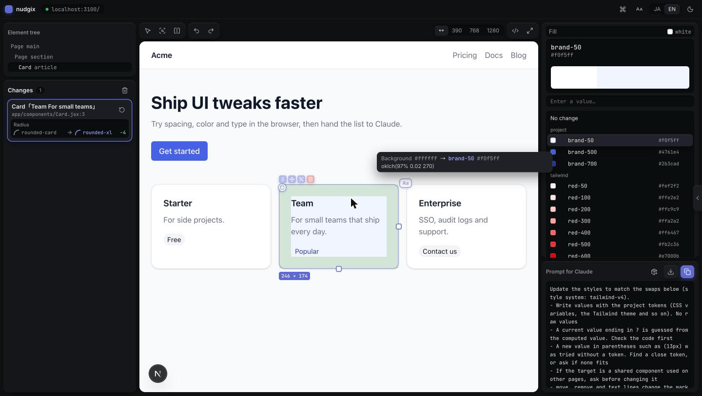
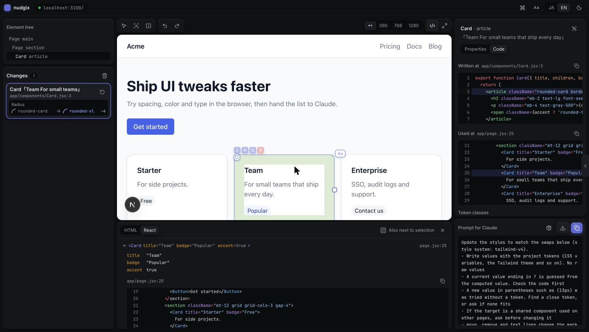

# nudgix

Nudge your local UI in the browser, then hand the list of tweaks to your coding agent as a prompt. The prompt is plain text, so it works with Claude Code, Codex, Cursor or any other agent. nudgix never edits your source.

[日本語](README.ja.md)



```sh
cd your-app
npm run dev          # start your dev server as usual
npx nudgix start     # opens the editor at http://localhost:4747/__nudgix/
```

nudgix shows your app in a frame and lets you try changes on it:

- Swap colors, type, spacing, size, radius and shadows for your project's tokens. The page updates while the cursor is on a token
- Drag spacing bands and handles on the page, reorder or move elements, edit text, remove elements, and offset them visually
- Place Storybook stories into the page and change their props
- See the selection as HTML and as React or Vue components (props and the source lines that wrote it), with the lines your changes will touch marked
- Leave a comment on an element for the agent, in your own words
- Copy everything as a prompt, one block per element: where it is written and what to change



## Style systems

nudgix reads tokens through an adapter, picked from `package.json`.

| Adapter | Tokens | Prompt |
|---|---|---|
| `tailwind-v4` | Tailwind's default theme and the project's `@theme` blocks | Utilities: `pt-4`, `rounded-xl`, `bg-brand-500` |
| `panda` | Panda CSS tokens, named from `styled-system/tokens` after `panda codegen` | Token paths: `'brand.500'`, `'6'` |
| `stylex` | `defineVars` in `*.stylex.*` files, matched to the page's variables by value | Variables: `colors.brand`, `space.s4` |
| `css-vars` | Custom properties on `:root` in the page's stylesheets. Works with any setup | Variable names: `--space-4` |

## Coding agents (MCP)

`nudgix mcp` is an MCP server for coding agents. The agent reads the changes with `get_nudges` instead of you pasting the prompt, and after editing it calls `check_nudges`: the editor takes its previews off, reads the reloaded page and answers ✓, ✗ (with the value the page has now) or ? per change. Keep `nudgix start` and the editor tab running.

```sh
claude mcp add nudgix -- npx nudgix mcp            # Claude Code
codex mcp add nudgix -- npx nudgix mcp             # Codex
```

Other agents take the same command (`npx nudgix mcp`, plus `--port` if the editor is not on 4747). The check button in the Changes panel runs the same check by hand.

## Options

```sh
npx nudgix start --target 3001 --port 4800
```

| Option | Default |
|---|---|
| `--target` | The port in your `dev` script (`next dev -p 3100`), else the framework's default: Next.js 3000, Vite 5173, Astro 4321 |
| `--port` | `4747` |
| `--dir` | The current folder |
| `--storybook` | `6006` |
| `--no-open` | Opens the browser |

## Claude Code skill

This part is optional and only for Claude Code. The prompt panel can install the `/apply-nudges` skill into your project (`.claude/skills/apply-nudges/`). With it, prompts drop the instructions and are just `/apply-nudges`, the adapter and the changes. An existing skill is never overwritten. If you also hand prompts to other agents, skip the skill: they would not know `/apply-nudges`.

## Limits

- Source locations need a React or Vue development build. For React, Next.js (Turbopack or webpack) and Vite are tested; other React setups may work. Vue only keeps the `.vue` file of each component, so nudgix searches that file for the element (by class, then tag) and the line can be off. Other frameworks (Svelte, Solid and so on) get no source location. Without React or Vue, nudgix points at the CSS rule that styles the element, when the dev server tells which file it came from (Vite does)
- The Storybook gallery does not work when the app itself runs on Vite, because both serve the same paths
- Changes are stored in the browser and found again by their position in the page, so they can get lost when the page structure changes

## Development

```sh
pnpm install
pnpm dev --dir examples/next-tailwind-v4   # runs the editor from source with Vite
pnpm build                                 # builds the editor into dist/
node server/tailwind.test.mjs
node server/stylex.test.mjs
```

The examples need their own `pnpm install` and `pnpm dev`. `examples/next-tailwind-v4` runs on port 3100, `examples/vite-css` on 5173, `examples/vite-react-panda` on 5174, `examples/vite-react-stylex` on 5175, `examples/vite-vue` on 5176.

## License

MIT
