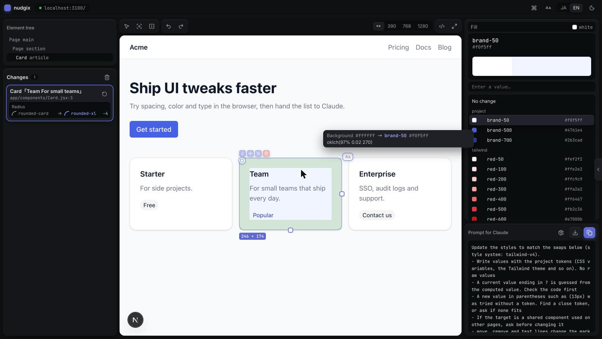
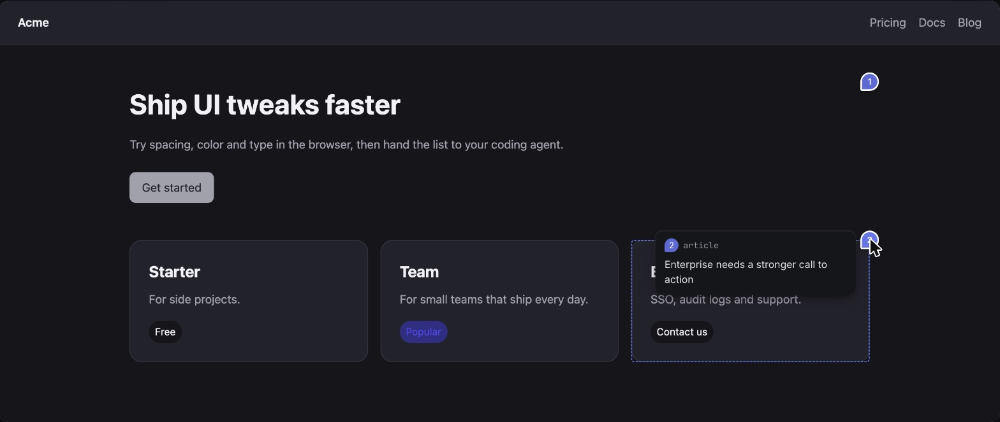
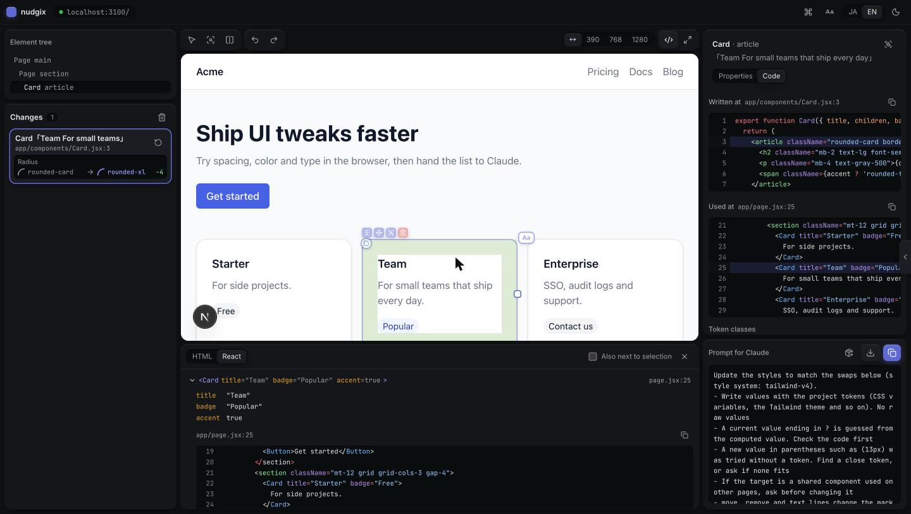

# nudgixの機能

nudgixは、手元のdevサーバーの画面をそのまま開き、見た目の変更を試してから、その変更をコーディングエージェント向けのプロンプトにする道具です。
試している間、ソースは書き換えません。
コードに反映するのは、エージェントがプロンプトを読んで直したときです。

[English](features.md)

## 画面の見方

真ん中がアプリの画面で、左右にパネルが並びます。

- 左上の要素ツリーには、選んだ要素から外側へ向かって、親の部品とタグが並びます。行にカーソルを置くとその要素に枠が出て、押すとその要素を選び直します
- 左下には、ページへのコメント欄と、確定した変更の一覧が要素ごとに並びます
- 右のパネルには、選んだ要素の状態とコメント欄、その下に並び、余白、サイズ、見た目（背景・枠線・角丸・影）、文字の項目が出ます
- 右下には、エージェントに渡すプロンプトが出ます

上のバーの左端には、画面の戻る・進む・再読み込みのボタンがあります。
起動したときにdevサーバーが止まっていれば、起動コマンドを出して待ちます。
devサーバーが立ち上がると、自動で画面を開きます。

## 要素を選ぶ

`S`を押してから画面の要素を押すと、その要素を選べます。
選んだあとに`↑`を押すと親へ、`↓`を押すと最初の子へ移ります。

複数の要素を選ぶ方法は3つあります。

- 選ぶモードで`Shift`を押しながら要素を押すと、選んでいる要素に足していきます
- 選ぶモードで画面の上をドラッグすると、囲んだ範囲の要素をまとめて選びます
- `A`で、選んでいる要素と同じ見た目（タグとclassの組み合わせが同じ）の要素を、画面の中からすべて選びます

複数の要素を選んでいる間は、トークンの差し替えがすべての要素に同時に当たります。
`Esc`を押すと、開いている一覧、選ぶモード、寄せた表示、選択の順に閉じます。

## トークンで差し替える



右のパネルの行（文字色、角丸など）を押すと、その項目で使えるトークンの一覧が開きます。
一覧のトークンにカーソルを置くか、`↑` `↓`で送ると、そのトークンが画面にすぐ当たります。
押すか`Enter`で確定し、`Esc`で元の値に戻します。

| グループ | 項目 |
|---|---|
| 色 | 文字色、背景色、枠線の色 |
| 文字 | 文字スタイル、文字サイズ、太さ |
| 余白 | 内側（上下左右）、子要素の間、外側（上下左右） |
| サイズ | 幅、高さ |
| 角丸 | 角丸 |
| 影 | 影 |

一覧の上の入力欄には、トークンに無い値をそのまま入れられます。
プロンプトでは`width (430px)→(300px)`のように括弧で包み、近いトークンを探すようエージェントに伝えます。

`⌘K`のコマンドパレットでは、プロパティ・トークン・操作をまとめて探せます。

### トークンの読み方

トークンはアダプターを通して読みます。アダプターは`package.json`から選びます。

| アダプター | トークン | 今の値の判定 | プロンプトでの書き方 |
|---|---|---|---|
| `tailwind-v4` | Tailwindの既定のテーマと、プロジェクトの`@theme` | ユーティリティのclass | `pt-4`、`bg-brand-500` |
| `panda` | Panda CSSのトークン。名前は`styled-system/tokens`から取る | classが使っているCSS変数 | `'brand.500'`、`'6'` |
| `stylex` | `*.stylex.*`の`defineVars`。画面のハッシュ化された変数とは値で突き合わせる | 規則が使っているCSS変数 | `colors.brand`、`space.s4` |
| `css-vars` | 画面のスタイルシートで`:root`に書かれたカスタムプロパティ | 規則が使っているCSS変数 | `--space-4` |

ソースから判定できないときは、計算値が同じトークンを候補として出します。
候補が1つに決まらないときは「どれか」と表示し、プロンプトでエージェントにコードを確かめさせます。

## 余白・サイズ・角丸を画面の上で動かす

選んだ要素には、余白の帯とハンドルが出ます。

- 余白は帯そのものをドラッグして変えます。内側の余白が緑、外側がオレンジ、子要素の間（gap）が紫です
- `⌥`を押しながら動かすと向かい合う2辺が、`⇧`を押しながら動かすと4辺がそろって変わります
- 右辺と下辺のハンドルで幅と高さを、左上の角で角丸を、右上の`Aa`で文字サイズを変えます

動かしている間は、近いトークンに吸い付きます。
`⌘`（Windowsでは`Ctrl`）を押しながら動かすと、吸い付かずに1px単位の値になります。
小さい要素は、`Z`で寄せると動かしやすくなります。

## 並び・移動・削除・文字

- 右のパネルの「並び」で、向き、揃え、両端揃え、伸ばすを変えます。flexでない要素は先にflexにします
- 選択の枠の左上のつまみで兄弟の中を並べ替え、別の要素の上で離すとその子へ移します。`⌥↑` `⌥↓`でも並べ替えられます
- 十字の矢印のボタンで、見た目だけ自由にずらします
- `Delete`で要素を消します。画面では隠しているだけで、変更一覧から元に戻せます
- 要素をダブルクリックすると、その場で文字を書き換えられます

## 状態を切り替える

右のパネルの「状態」で、選んだ要素を`:hover`、`:focus`、`:active`の見た目にします。
ツールバーの月のボタンでは、ページ全体をダークモードで表示します。
ページの`prefers-color-scheme`のメディア規則を切り替え、`html`に`dark`クラスと`data-theme="dark"`を付けます。

状態を当てた要素は、その状態での値を「今」の値として読み直します。
その状態で入れた変更には、プロンプトで`state hover, dark`のような行が付き、エージェントはその状態のときのスタイルだけを変えます。

状態は、ページのCSSで`:hover`などを使っている規則を複製して、属性で当てています。
そのため、スクリプトで付け外しするclassで作った状態には効きません。

## コメントを付ける



変更だけでは伝わらない頼みごとは、コメントで書きます。
コメントはプロンプトに`note "…"`の行として入り、エージェントはその要素への依頼として扱います。

- ツールバーのコメントツール（`M`）を押して要素を選ぶと、要素の横に入力欄が開きます。`Enter`で確定し、`Shift+Enter`で改行、`Esc`で閉じます
- コメントツールで画面をドラッグすると、囲んだ複数の要素にまとめてコメントできます。コメントはそれらの共通の親に付き、プロンプトには`note about .card ×2 "…"`のように対象が入ります
- 変更一覧の上の欄には、ページ全体へのコメントを書けます
- 右のパネルの欄からも、選んだ要素のコメントを書き直せます

コメントを付けた要素には、Figmaのような番号付きのピンが出ます。
ピンにカーソルを置くとコメントのカードが出て、対象の要素を点線で囲みます。
ピンを押すと、その要素を選んで入力欄を開きます。

## Storybookの部品を置く

画面の右端の`<`を押すと、Storybookのストーリーがギャラリーとして開きます。
カードを画面へドラッグすると、そのストーリーの見た目を、離した場所に差し込みます。
差し込んだ部品を選ぶと、右のパネルでPropsを変えられます。

ギャラリーは、プロジェクトの依存にStorybookがあり、Storybookが起動しているときに使えます。
番号が6006でないときは、`--storybook`で指定します。

## コードを見る



`C`かツールバーの`</>`ボタンで、画面の下にドロワーが開きます。

- HTMLタブは、選んだ要素のHTMLを折りたためる木で出します。「全体」でページ全体の木にします
- React（Vue）タブは、選んだ要素から近い順に部品を並べ、Propsと、部品を書いた場所のソースを出します
- 右のパネルの「コード」タブは、要素を書いた場所と使っている場所、変更が入る行への注記、部品を使っている箇所の数を出します

書いた場所が分かるのは、ReactかVueの開発ビルドのときです。
Vueは`.vue`ファイルしか分からないので、ファイルの中で要素をクラス名、次にタグ名で探します。
ReactもVueも使っていない画面では、要素に当たっているCSSの規則の場所を出します（devサーバーがファイル名を教えてくれるときだけ）。

## 見え方を切り替える

| 操作 | キー |
|---|---|
| パネルを並べる表示と全画面の表示を切り替える | `F` |
| 押している間だけ変更前の画面を出す | `\` |
| 選んだ要素に寄せる | `Z` |
| 元に戻す / やり直す | `⌘Z` / `⇧⌘Z` |

ツールバーの`390` `768` `1280`で、画面の幅をスマホ、タブレット、PCの幅にします。
ほかに、エディタのUIの大きさ、ライトとダーク、日本語と英語を切り替えられます。

## エージェントに渡す

### プロンプト

確定した変更とコメントは、要素ごとにプロンプトになります。
各ブロックの1行目は、その要素を書いたファイルと行、部品名、文字の頭です。
2行目からは、トークンの差し替え、並び、移動、文字、状態、コメントの行が並びます。

右上のボタンで、プロンプトをコピー（`⌘⇧C`）するか、`.md`で保存します。
プロンプトはただのテキストなので、どのエージェントにも渡せます。

Claude Codeを使っているなら、プロンプト欄のボタンで`/apply-nudges`スキルを入れられます。
入れると、プロンプトは進め方の説明を省いて、`/apply-nudges`と変更の行だけになります。

### MCP

`nudgix mcp`は、コーディングエージェント向けのMCPサーバーです。

| ツール | すること |
|---|---|
| `get_nudges` | 今の変更とコメントを、進め方の説明つきのプロンプトとして返す |
| `check_nudges` | エディタに確認を頼み、変更ごとに✓、✗、?を返す |

```sh
claude mcp add nudgix -- npx nudgix mcp
```

MCPサーバーは、動いている`nudgix start`から変更を読みます。
エディタのタブは開いたままにしてください。

### 直ったかを確かめる

エージェントがコードを直したあと、変更一覧の確認ボタンか`check_nudges`で、変更がコードに入ったかを確かめます。
nudgixはプレビューを一瞬外し、読み込み直した画面のスタイルだけで判定します。

| 印 | 意味 |
|---|---|
| ✓ | 狙ったトークンや値になっている |
| ✗ | まだなっていない。今の値も出す |
| ? | 画面からは確かめられない（並べ替え、ずらし、差し込み、コメント） |

文字の書き換えは、要素を書いたファイルに新しい文字があるかで確かめます。

### 変更の保存と取り消し

確定した変更はプロジェクトのフォルダごとにブラウザに保存し、再読み込みしたあとも画面に当て直します。
変更一覧では、要素ごとに元に戻すか、ごみ箱で全部取り消せます。

要素は画面の中の位置で探すので、画面の構造が変わると見つからないことがあります。
見つからない要素は「画面に無い」と表示し、プロンプトには残します。
