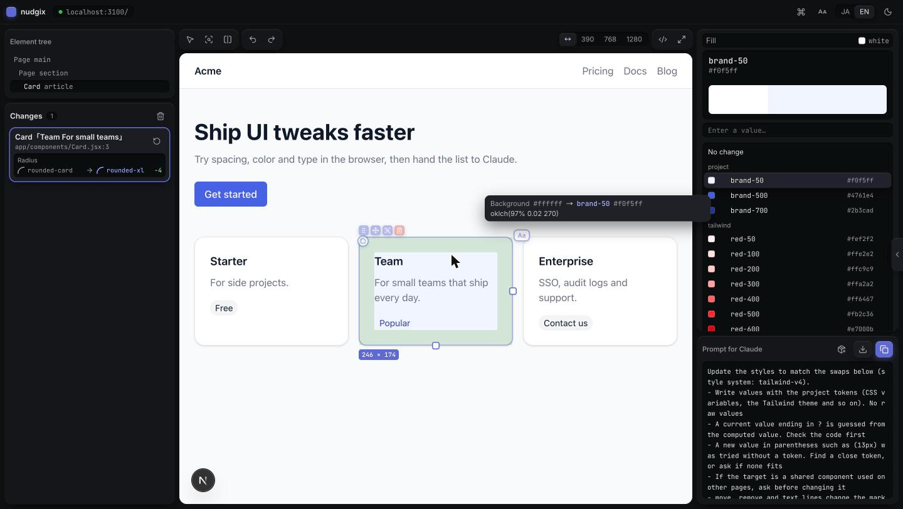
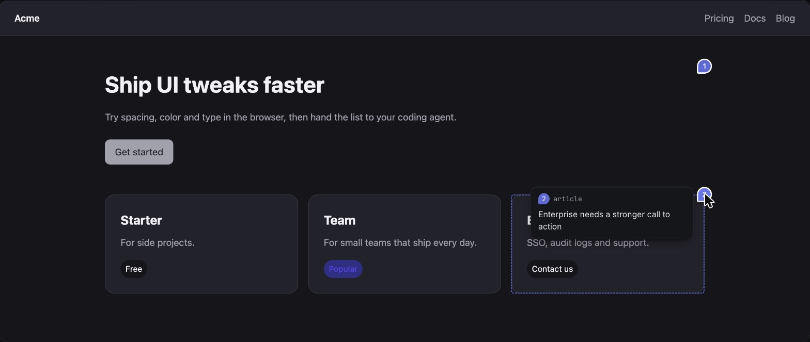
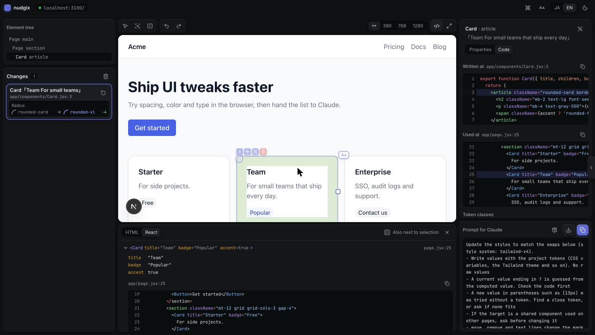

# nudgix features

nudgix opens your local dev server's page as it is, lets you try visual changes on it, and turns those changes into a prompt for your coding agent.
It never edits your source while you try things.
The code changes when the agent reads the prompt and edits it.

[日本語](features.ja.md)

## The screen

The app is in the middle, with panels on both sides.

- The element tree (top left) lists the parent components and tags from the selection outwards. Hovering a row outlines that element; clicking selects it
- Below it are the comment box for the whole page and the list of committed changes, one card per element
- The right panel shows the selection's states and comment box, then layout, spacing, size, appearance (fill, stroke, radius, shadow) and text
- The prompt for your agent is at the bottom right

The top bar starts with back, forward and reload buttons for the page.
If the dev server is not running at start, nudgix shows the command to start it and waits; the page opens once it is up.

## Selecting

Press `S`, then click an element on the page.
After that, `↑` moves to the parent and `↓` to the first child.

There are three ways to select several elements:

- In selection mode, `Shift`-click adds elements
- In selection mode, drag on the page to select the elements inside the box
- `A` selects every element on the page that looks the same (same tag and classes)

With several elements selected, token swaps apply to all of them.
`Esc` closes, in order, an open list, selection mode, the zoomed view and the selection.

## Swapping tokens



Click a row in the right panel (text color, radius and so on) to open the tokens for it.
Hovering a token, or stepping with `↑` `↓`, applies it to the page right away.
Click or `Enter` commits; `Esc` goes back to the original value.

| Group | Properties |
|---|---|
| Color | Text, fill, stroke |
| Text | Text style, size, weight |
| Spacing | Padding (each side), gap, margin (each side) |
| Size | Width, height |
| Radius | Radius |
| Shadow | Shadow |

The field above the list takes values outside the tokens.
The prompt wraps them in parentheses, like `width (430px)→(300px)`, and asks the agent to find a close token.

The command palette (`⌘K`) searches properties, tokens and actions together.

### How tokens are read

nudgix reads tokens through an adapter, picked from `package.json`.

| Adapter | Tokens | Current value from | Prompt |
|---|---|---|---|
| `tailwind-v4` | Tailwind's default theme and the project's `@theme` blocks | Utility classes | `pt-4`, `bg-brand-500` |
| `panda` | Panda CSS tokens, named from `styled-system/tokens` | The CSS variable a class uses | `'brand.500'`, `'6'` |
| `stylex` | `defineVars` in `*.stylex.*` files, matched to the page's hashed variables by value | The CSS variable a rule uses | `colors.brand`, `space.s4` |
| `css-vars` | Custom properties on `:root` in the page's stylesheets | The CSS variable a rule uses | `--space-4` |

When the source does not tell, tokens with the same computed value are shown as candidates.
If more than one fits, the panel says "one of" and the prompt asks the agent to check the code.

## Moving spacing, size and radius on the page

The selection gets spacing bands and handles.

- Drag a band to change that spacing: padding is green, margin orange, gap purple
- Hold `⌥` to move two opposite sides together, `⇧` to move all four
- The right and bottom handles change width and height, the top-left corner the radius, and `Aa` at the top right the font size

While dragging, values snap to the nearest token.
Hold `⌘` (`Ctrl` on Windows) to move in 1px steps without snapping.
Zoom to small elements with `Z`.

## Layout, moving, removing and text

- The Layout section changes direction, alignment, space-between and stretch. Elements that are not flex become flex first
- The grip at the selection's top left reorders siblings; dropping on another element moves into it. `⌥↑` `⌥↓` reorder too
- The cross-arrows button offsets the element visually
- `Delete` removes the element. It is only hidden on the page and can be restored from the change list
- Double-click an element to edit its text in place

## States

The State chips in the right panel show the selection as `:hover`, `:focus` or `:active`.
The moon button in the toolbar shows the whole page in dark mode: it flips the page's `prefers-color-scheme` media rules and adds the `dark` class and `data-theme="dark"` to `html`.

Current values are read again in the forced state.
Changes made in a state get a line like `state hover, dark` in the prompt, and the agent changes the style for that state only.

States work by copying every rule that uses `:hover` and the like so that it matches an attribute instead.
States made with classes that scripts add and remove are not covered.

## Comments



Write what the changes alone cannot say as a comment.
Comments go into the prompt as `note "…"` lines, and the agent treats them as requests for that element.

- Pick the comment tool (`M`) in the toolbar and click an element: a comment box opens next to it. `Enter` saves, `Shift+Enter` adds a line, `Esc` closes
- Drag with the comment tool to comment on several elements at once. The comment sits on their common parent, and the prompt names them, like `note about .card ×2 "…"`
- The box above the change list holds a comment on the whole page
- The box in the right panel edits the selection's comment too

Commented elements get numbered pins, like Figma.
Hovering a pin shows the comment on a card and outlines the element; clicking it selects the element and opens the comment box.

## Storybook stories

The `<` at the right edge opens Storybook's stories as a gallery.
Drag a card onto the page to insert that story's markup where you drop it.
Select an inserted story to change its props in the right panel.

The gallery needs Storybook in the project's dependencies and running.
Pass `--storybook` if it is not on port 6006.

## Code



`C` or the `</>` button opens a drawer at the bottom.

- The HTML tab shows the selection's HTML as a collapsible tree. "Whole page" shows the whole page
- The React (or Vue) tab lists the components from the selection outwards, with their props and the source where each is written
- The Code tab in the right panel shows where the element is written and used, notes on the lines a change will touch, and how many places use the component

Source locations need a React or Vue development build.
Vue only keeps the `.vue` file, so nudgix searches it for the element by class, then by tag.
Pages without React or Vue get the location of the CSS rule that styles the element, when the dev server tells which file it came from.

## View

| Action | Key |
|---|---|
| Switch between docked panels and full screen | `F` |
| Show the page before your changes while held | `\` |
| Zoom to the selection | `Z` |
| Undo / redo | `⌘Z` / `⇧⌘Z` |

`390` `768` `1280` in the toolbar set the page width to phone, tablet and desktop.
The toolbar also switches the editor's UI size, light and dark, and English and Japanese.

## Handing off to the agent

### Prompt

Committed changes and comments become a prompt, one block per element.
The first line of each block is the file and line that wrote the element, the component and the start of its text.
The lines after it are token swaps, layout, moves, text, state and comments.

The buttons at the top right copy the prompt (`⌘⇧C`) or save it as `.md`.
The prompt is plain text, so any agent can take it.

With Claude Code, the button in the prompt panel installs the `/apply-nudges` skill.
With it, the prompt drops the instructions and is just `/apply-nudges` and the change lines.

### MCP

`nudgix mcp` is an MCP server for coding agents.

| Tool | What it does |
|---|---|
| `get_nudges` | Returns the current changes and comments as a prompt with instructions |
| `check_nudges` | Asks the editor to check, and returns ✓, ✗ or ? per change |

```sh
claude mcp add nudgix -- npx nudgix mcp
```

The MCP server reads the changes from a running `nudgix start`.
Keep the editor tab open.

### Checking the result

After the agent edits the code, the check button in the change list, or `check_nudges`, tells whether each change made it into the code.
nudgix takes its previews off for a moment and judges from the reloaded page's own styles.

| Mark | Meaning |
|---|---|
| ✓ | The element has the target token or value |
| ✗ | Not yet. The value the page has now is shown |
| ? | Cannot be checked from the page (reordering, offsets, inserted stories, comments) |

Text edits are checked by looking for the new text in the file that writes the element.

### Saving and undoing

Committed changes are stored in the browser per project folder and applied again after a reload.
The change list reverts one element at a time, or everything with the trash button.

Elements are found again by their position in the page, so they can get lost when the page structure changes.
Those show as "Not on page" and stay in the prompt.
